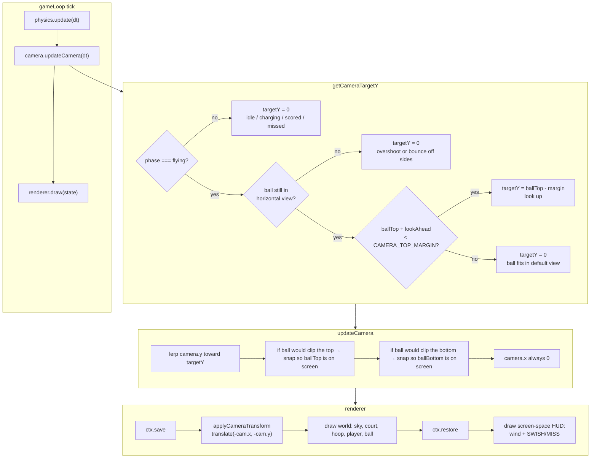
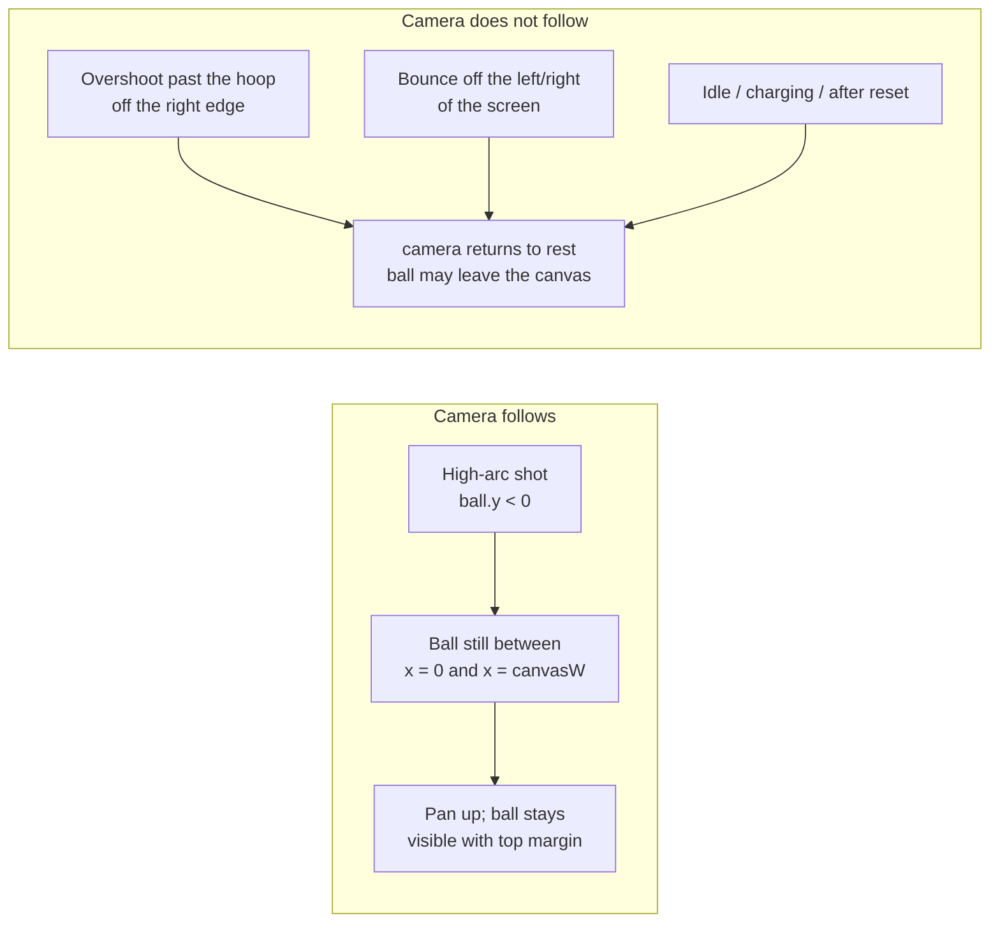

# Free Throw Frenzy — Dynamic Camera

High-arc free throws peak above the default 900×500 framing. The camera pans **vertically** so the ball stays on screen, and never pans **horizontally** — overshoots and side-bounces still leave the play area as misses.

