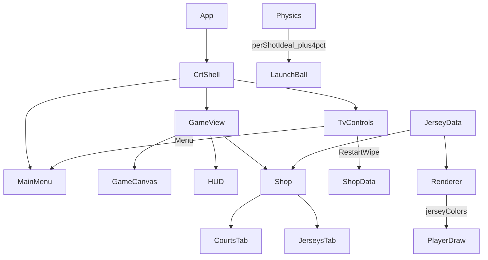

# CRT Shell — Phase 11

## Control flow
1. Menu and game render inside `CrtShell` screen glass.
2. **Restart** calls `resetEconomyAndUnlocks`, remounts game key / refreshes menu stats.
3. **Menu** returns to difficulty select without wiping progress.
4. Shop Jerseys tab writes `activeJersey`; renderer reads it each frame.
