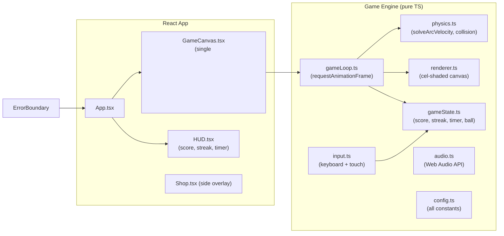

# Architecture — Free Throw Frenzy

## High-Level Overview



## Component Responsibilities

| Component | File | Role |
|-----------|------|------|
| App | `src/App.tsx` | Root; mounts Canvas + HUD |
| GameCanvas | `src/components/GameCanvas.tsx` | Owns `<canvas>`, starts game loop |
| HUD | `src/components/HUD.tsx` | React overlay for score/streak/timer |
| gameLoop | `src/engine/gameLoop.ts` | rAF loop; calls update + render each frame |
| physics | `src/engine/physics.ts` | Gravity, trajectory, collision detection |
| input | `src/engine/input.ts` | Spacebar / touch listeners; charge tracking |
| renderer | `src/engine/renderer.ts` | All canvas draw calls (court, player, ball, hoop) |
| gameState | `src/engine/gameState.ts` | Central mutable state object |

## Data Flow (per frame)
1. `input.ts` updates charge/power in `gameState`.
2. `gameLoop.ts` calls `physics.update(dt)` → moves ball, checks collisions.
3. `gameLoop.ts` calls `renderer.draw(state)` → clears canvas, redraws scene.
4. On score/miss event, `gameState` updates score/streak/multiplier; React HUD re-renders via callback.

## Directory Layout
```
free-throw-frenzy/
├── public/          # index.html, manifest
├── src/
│   ├── App.tsx
│   ├── components/  # GameCanvas, HUD
│   ├── engine/      # gameLoop, physics, input, renderer, gameState
│   ├── styles/      # Tailwind + CSS files
│   └── types/       # shared TS interfaces
├── tests/           # unit tests
├── utils/           # reusable helpers
├── docs/            # memory files
├── tasks/           # planning files
└── diagrams/        # mermaid diagram files
```

## Key Decisions
- **No game engine**: Custom physics keeps bundle tiny and demonstrates skill.
- **Single canvas**: Simpler compositing; HUD is a React overlay, not drawn on canvas.
- **State outside React**: Game state is a plain TS object mutated each frame for performance; React only reads it for HUD via callbacks/refs.
- **Exact arc solver**: `solveArcVelocity` computes the initial velocity vector needed to hit a target at a given peak height, guaranteeing makeable shots.
- **Cel-shaded rendering**: Multi-tone fills with consistent dark outlines for a stylized cartoon look.
- **Web Audio API**: Synthesized sounds (no audio files) — keeps bundle small and loads instantly.
- **Error boundary**: Prevents full-page crashes; offers recovery UI.
- **Config module**: Single source of truth for all tunable game constants.
