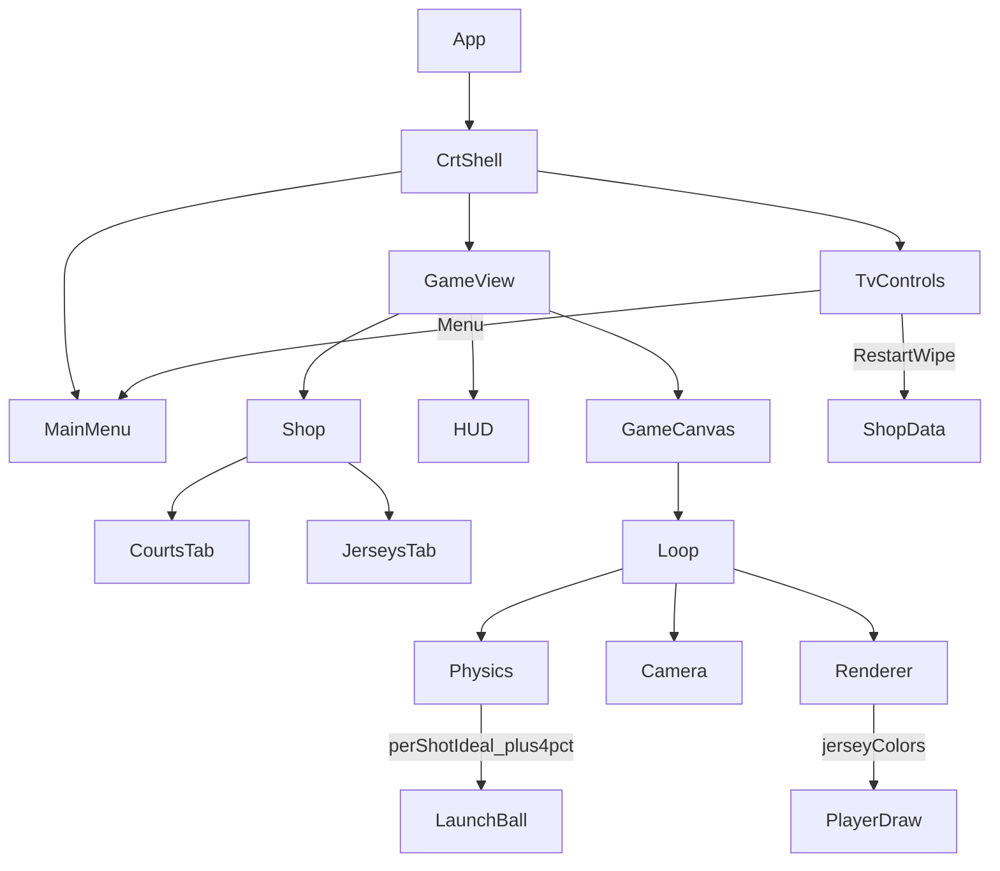

# Architecture — Free Throw Frenzy

## High-Level Overview



## Component Responsibilities

| Component | File | Role |
|-----------|------|------|
| App | `src/App.tsx` | Screen routing (`menu` \| `game`); coins/pause/shop wiring |
| CrtShell | `src/components/CrtShell.tsx` *(Phase 11)* | CRT bezel + screen glass; wraps menu + game; TV Restart/Menu |
| MainMenu | `src/components/MainMenu.tsx` | Difficulty picker inside CRT screen |
| GameCanvas | `src/components/GameCanvas.tsx` | Canvas + game loop mount |
| HUD | `src/components/HUD.tsx` | Score/streak/timer overlay |
| Shop | `src/components/Shop.tsx` | Side overlay; Courts + Jerseys tabs |
| shopData | `src/utils/shopData.ts` | Coins, backgrounds; restart wipe helpers |
| jerseyData | `src/utils/jerseyData.ts` *(Phase 11)* | 30 NBA teams; unlock/active persistence |
| physics | `src/engine/physics.ts` | Trajectory; per-shot ideal; +4% near-zone bonus |
| camera | `src/engine/camera.ts` | Vertical follow only |
| renderer | `src/engine/renderer.ts` | Cel-shaded draws; jersey color tint |
| input | `src/engine/input.ts` | Spacebar + touch charge |
| gameLoop | `src/engine/gameLoop.ts` | rAF update/render |

## Data Flow (per frame)
1. Input updates charge in `gameState`.
2. Physics updates ball / collisions; launch uses **per-shot ideal** + **+4%** near-zone make boost.
3. Camera pans Y if needed.
4. Renderer draws world (jersey colors from active team) then screen-space overlays.
5. React HUD/Shop read state via callbacks.

## Restart Wipe Flow
`TvControls.Restart` → clear coins/unlocked BGs/jerseys in localStorage → remount game key / reset UI coin state. High score key untouched.

## Directory Layout
```
free-throw-frenzy/
├── public/
├── src/
│   ├── App.tsx
│   ├── components/   # CrtShell, MainMenu, GameCanvas, HUD, Shop, …
│   ├── engine/
│   ├── styles/       # index.css, crtTv.css (Phase 11)
│   ├── types/
│   ├── utils/        # shopData, jerseyData, difficultyData, …
│   └── tests/        # camelCase unit tests (CRA-safe; was root tests/ + __tests__)
├── docs/
├── tasks/
└── diagrams/
```

## Key Decisions
- **CRT is DOM/CSS**, not canvas — keeps game loop untouched and responsive.
- **Jerseys = colors only** (30 teams); no logo assets.
- **Restart is destructive** to economy/unlocks by design (glitch fail-safe).
- **Ideal power is per-shot state**, not only difficulty baseline.
- **Tests under `src/tests/`** so CRA imports work without eject.
- Existing: custom physics, single canvas, vertical camera, Web Audio, config module.
